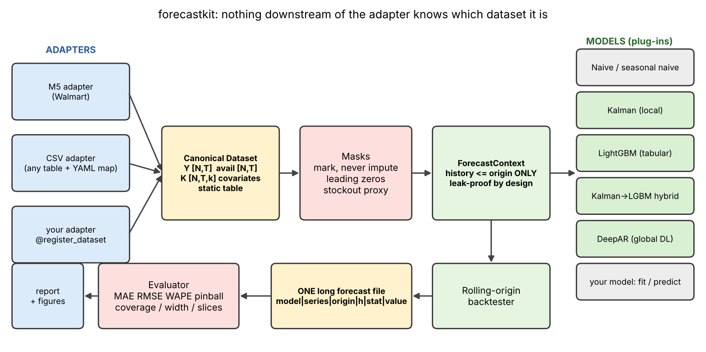

# forecastkit

**An open, model-agnostic toolkit for probabilistic demand forecasting** — leak-safe rolling-origin backtesting, fair stockout handling, and apples-to-apples evaluation of *local* (Kalman), *tabular* (LightGBM) and *global deep* (DeepAR) models. Built for the AML project **"Inventory Demand Forecasting via Kalman Filtering and Global DeepAR Models"** (M5), but nothing downstream of the dataset adapter knows it is M5.



## Why it is reusable (the 5 rules)

1. **One data contract** – every dataset becomes `Dataset(Y, avail, K, static)` via a small *adapter*. Only adapters know raw formats.
2. **One model interface** – `fit(ctx)` and `predict(quantiles)`. A new model is one file.
3. **One forecast file** – long format `model | series_id | origin | h | ds | stat | value`; evaluation reads only this, so even forecasts from other tools can be scored.
4. **Everything in YAML** – dataset, subset, masks, origins, horizon, quantiles, models, hyper-parameters. New project = new config.
5. **Leak-proof by construction** – the `ForecastContext` handed to a model physically contains no target after the origin (see *Guarantees*).

## Quickstart

```bash
pip install -e ".[all]"            # numpy/pandas/scipy + lightgbm + torch + pytest
make test                          # 35 tests: leakage, metrics, splits, masks, model contract, plug-ins
make smoke                         # ~3 min, synthetic data in EXACT M5 file format, all 8 models + report
make demo-csv                      # same toolkit on a non-M5 CSV (bakery sales): only the adapter block changes
```

Real M5 run (see [docs/RUN_REAL_M5.md](docs/RUN_REAL_M5.md)):

```bash
# put calendar.csv, sell_prices.csv, sales_train_evaluation.csv in data/raw/m5/
forecastkit subset configs/m5.yaml     # freezes configs/subsets/m5_subset.csv  (commit it!)
forecastkit all    configs/m5.yaml     # backtest -> tables -> figures -> outputs/m5_main/report/RESULTS.md
make ablations                         # DeepAR / stockout / Kalman / LightGBM ablation tables
```

Outputs per run: `forecasts.parquet`, `timing.csv`, `config.yaml` (exact config), `series_info.csv`, and `report/` with `RESULTS.md`, CSV tables and 9 figures.

## What is inside

| Layer | What | Where |
|---|---|---|
| Adapters | M5 (Walmart), generic long-CSV with YAML column map, synthetic M5-format generator | `datasets/` |
| Masks | availability (price-based + leading zeros), **stockout proxy** (zero-run vs series' own ADI), mark-never-impute | `masks.py` |
| Models | naive / seasonal-naive / moving-average · **Kalman** (local level + stochastic weekly seasonal, batched, missing-obs aware) · **LightGBM** (direct by horizon bucket, Poisson mean + quantile models) · **Kalman→LightGBM hybrid** · **DeepAR** (NegBin / Gaussian / Student-t, embeddings, loss masking, unknown-item embedding, warm start, CPU/GPU) | `models/` |
| Backtest | rolling origins (+ validation origin), leak-proof context, simulated cold start, tuning on validation only, ablation runner | `backtest/` |
| Evaluation | MAE, RMSE, WAPE (aggregated), pinball, wQL, 80/90 % coverage & width, calibration (discrete-aware), by horizon / slice / origin / cold-start / censored vs not, paired bootstrap significance, quantile-average ensembles | `evaluation/` |
| Reporting | 9 figures + auto-generated `RESULTS.md` (no hand-typed numbers) | `viz/`, `report/` |

## Add a dataset (≈10 lines)

```python
# my_adapters.py
import numpy as np, pandas as pd
from forecastkit import Dataset, register_dataset

@register_dataset("my_shop")
def load(path, name="my_shop"):
    df = pd.read_csv(path, parse_dates=["day"])
    ...                                   # build Y [N,T], avail [N,T], K [N,T,k], static (index = series_id)
    return Dataset(name, series_ids, dates, Y, avail, K, known_names, static, season=7,
                   meta={"static_cat_cols": ["region"], "item_col": None})
```
then in YAML: `dataset: {type: "my_adapters:load", params: {path: data/shop.csv}}`.
For tables of *(series keys, date, target)* you do not even need code — use `type: csv` (see `configs/example_csv.yaml`).

## Add a model (≈10 lines)

```python
from forecastkit import BaseForecaster, register_model

@register_model("my_model")
class MyModel(BaseForecaster):
    def fit(self, ctx):                 # ctx.y [N,Th] (NaN = masked), ctx.known_hist/known_fut, ctx.static ...
        self.ctx = ctx; ...             # you can only see history <= origin
        return self
    def predict(self, quantiles):       # -> [N, H, Q] non-negative quantiles (+ optional mean [N, H])
        return self.finalize(q, mean=m)
```
then `models: {mine: {type: my_model, params: {...}}}` — or `type: "my_pkg.mod:MyModel"` without registering.

## Guarantees (tested in `tests/`)

* **No future leakage** – scrambling every target after the origin changes neither the context nor *any* model's forecast (`test_leakage.py`, all 6 model families).
* Stockout / leading-zero masks are **recomputed on the history slice** at each origin, so a flag never depends on the future.
* Validation origin(s) are strictly earlier than all test windows; `tune` only touches them.
* Metric definitions are unit-tested on toy data (aggregated WAPE ≠ mean of ratios; pinball asymmetry; perfect forecast ⇒ 0).
* Evaluation ground-truth stockout labels are hindsight labels used **only for scoring**, and are frozen across ablation variants.

## Honest limitations

* M5 has **no inventory data**: the stockout flag is a *proxy*, not ground truth (rule + sensitivity runs are provided).
* Cold start is **simulated** (a series reveals only its last N days and its item embedding is "unknown"); late-launched M5 items are handled by availability masks.
* Kalman is Gaussian on a transformed (√) scale; on very intermittent series it is a poor likelihood — a documented, reported weakness, not hidden.
* Count-data calibration is evaluated with both `<` and `≤` bounds; interval coverage uses inclusive bounds (generous with zeros).
* DeepAR is a compact in-repo PyTorch implementation (not GluonTS). The CPU path is tested; the CUDA path uses the same code with a device switch and has not been exercised in this environment.
* The `reports/example_synthetic_run/` outputs are from **synthetic** data to show the format; they are not M5 results.

## Citations

Kalman (1960) *A New Approach to Linear Filtering and Prediction Problems* · Salinas, Flunkert, Gasthaus, Januschowski (2020) *DeepAR*, IJF · Makridakis, Spiliotis, Assimakopoulos (2022) *M5 accuracy competition*, IJF · Syntetos & Boylan (2005) demand categorisation · Ke et al. (2017) LightGBM · Durbin & Koopman (2012) *Time Series Analysis by State Space Methods* · Gneiting & Raftery (2007) proper scoring rules.

MIT licensed.
