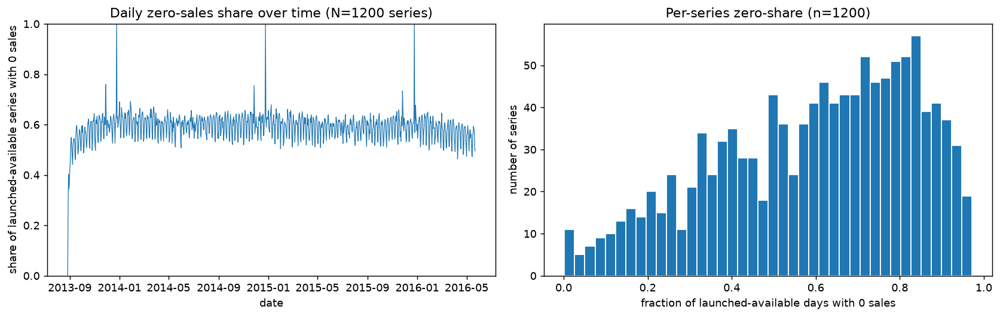
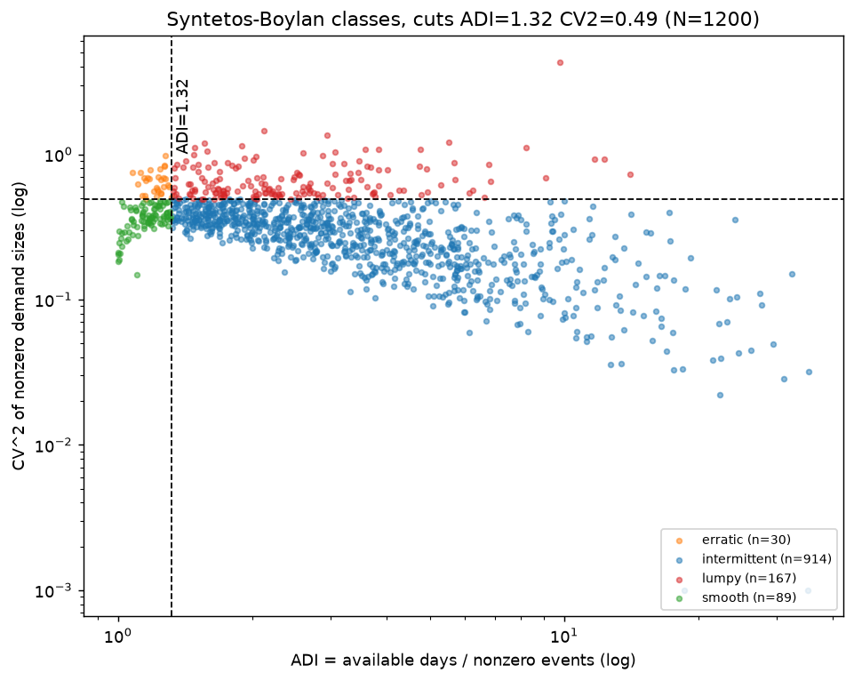
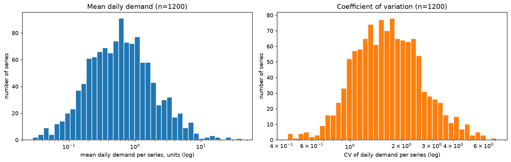
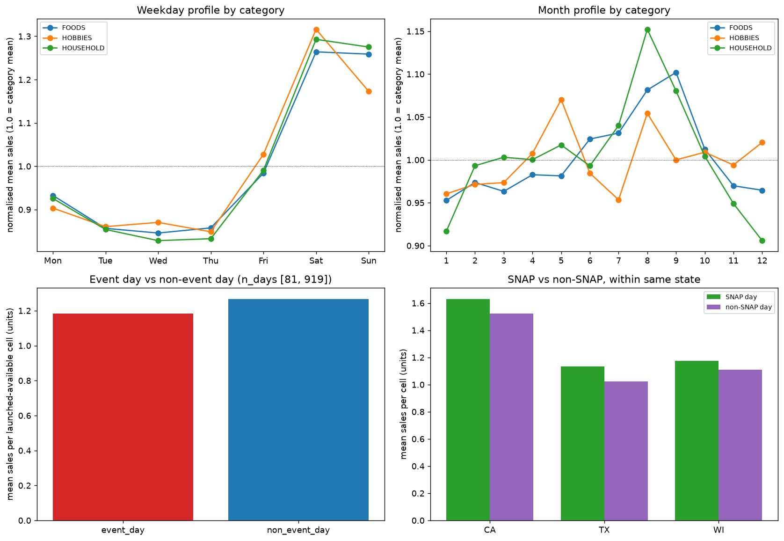
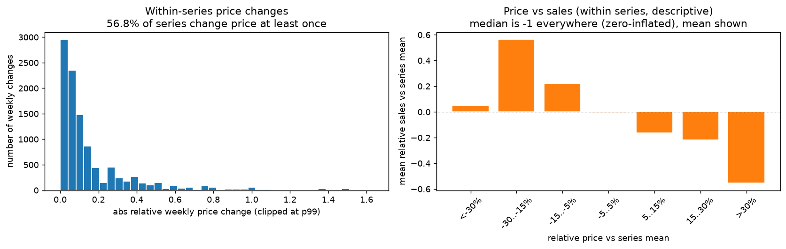
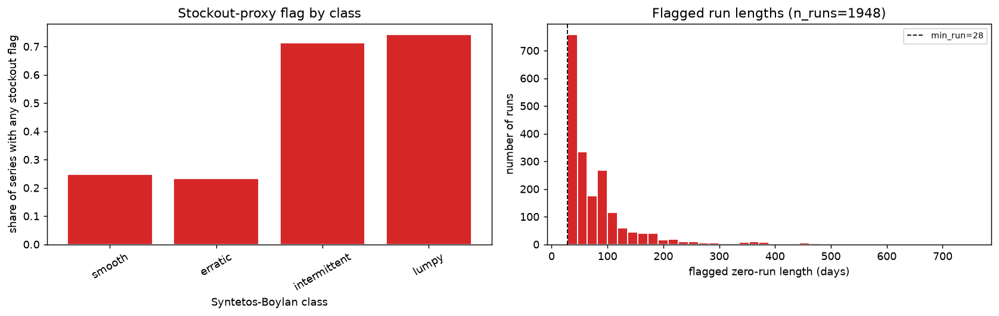

# M5 subset EDA findings

Workstream A, Phase 1 ML evidence package. This is exploratory data analysis of the
frozen M5 subset used by forecastkit. It describes the data only. No statistic here is
fed to any model.

## Reproduce

```bash
/tmp/fkvenv/bin/python scripts/eda_m5.py \
    --config configs/m5.yaml \
    --fig-dir docs/figures/eda \
    --out-dir outputs/eda
```

Runtime about 6 seconds (dataset served from the cache in `data/processed`). Fixed seed 42,
matplotlib Agg backend, dpi 130.

## Setup

The dataset is loaded through the repo loader (`forecastkit.datasets.load_dataset`) using
`configs/m5.yaml`. All intermittency and mask definitions come from the repo
(`classify_demand`, `leading_zero_mask`, `stockout_mask`). The script does not redefine them.

Verified dimensions (`outputs/eda/dataset_summary.csv`):

| Field | Value |
|---|---|
| series | 1200 |
| days | 1000 |
| date range | 2013-08-27 to 2016-05-22 |
| known covariates | 23 |
| cells available | 95.64% |
| cells launched and available | 94.06% |
| cells flagged as stockout proxy | 12.97% |
| mean daily demand per series | 1.25 units |
| zero share on launched-available cells | 59.11% |
| season | 7 |

Composition: 400 series per state (CA, TX, WI). By category: FOODS 566, HOUSEHOLD 410,
HOBBIES 224 (from the loaded static table). All three facts given to this workstream match:
1200 series, 1000 days, 95.64% availability (the run log said 95.6%).

"Available" means the item had a weekly price entry that week. The M5 adapter treats no price
as not on sale, so an unavailable cell is not demand. "Launched and available" additionally
drops the leading-zero block before a series' first sale.

## Quality checks

Raw files were read once, reading only the subset rows and the columns needed
(`sell_prices.csv` filtered to the 3 stores and subset items). Source:
`outputs/eda/quality_checks.csv`.

| Check | Value |
|---|---|
| sales rows in subset | 1200 |
| duplicate series ids | 0 |
| negative unit sales in raw | 0 |
| missing cells in raw sales grid | 0 |
| weekly price rows for subset | 701313 |
| duplicate store-item-week price rows | 0 |
| non-positive sell_price | 0 |
| missing sell_price | 0 |
| duplicate calendar dates | 0 |
| NaN target on available cells | 0 |
| negative targets in processed grid | 0 |

The raw sales grid is complete and clean. There are no duplicates, no negatives, and no
missing values in the subset.

## Definitions (from the repo, not redefined here)

ADI (average demand interval) and CV^2 come from `classify_demand` in
`src/forecastkit/features/intermittency.py`. For each series, over the window:

- Pre-first-sale days are dropped (same leading-zero idea).
- `ADI = available days / number of nonzero sales events`.
- `CV^2 = (std / mean)^2` of the nonzero sale sizes only (not of the full series).
- Syntetos-Boylan cuts are `ADI_CUT = 1.32` and `CV2_CUT = 0.49`.
  - ADI < 1.32 and CV^2 < 0.49: smooth
  - ADI < 1.32 and CV^2 >= 0.49: erratic
  - ADI >= 1.32 and CV^2 < 0.49: intermittent
  - ADI >= 1.32 and CV^2 >= 0.49: lumpy
- A series with zero nonzero events is labelled `no_sales`. In the backtester's `prepare`,
  `no_sales` (nothing sold before the first origin) is renamed `new_item`. In this EDA,
  classes are computed over the full window, so no series lands in `no_sales` or `new_item`.

The stockout proxy is `zero_run_stockout` in `src/forecastkit/masks.py`. For each series with
at least `min_nonzero_events = 10` sales events, it flags any run of available zero days with
length `>= max(min_run, adi_multiplier * ADI)`, where `min_run = 28` and `adi_multiplier = 3.0`
from `configs/m5.yaml`. `leading_zero_mask` flags available days before a series' first positive
sale.

## Leakage note

This EDA is descriptive over the full 1000-day window, including the test period. The test
origins are 2016-01-31, 2016-02-28, 2016-03-27, 2016-04-24 (validation origin 2016-01-03),
each with a 28-day horizon, so the last test window ends on 2016-05-22. The figures and tables
here therefore cover the test period and must not be read as inputs to any model.

No EDA number is used by any model. Models recompute masks and classes causally per origin.
`src/forecastkit/backtest/context.py` builds each `ForecastContext` by slicing targets at the
origin (`y_raw = ds.Y[:, :Th]`) and recomputing `leading_zero_mask` and `stockout_mask` on that
history slice only. `src/forecastkit/backtest/runner.py` computes slice labels with
`classify_demand(..., end=cutoff)` where `cutoff` is before the first origin. So the class
labels used for scoring never see test data, and the per-origin masks never depend on the
future.

## Figures

### 1. Zero-sales share



The left panel is the daily share of launched-available series that sold zero that day; it sits
near 0.6 after the ramp-up and dips on weekends. The right panel is the per-series zero-share,
spread widely with mass toward high values. Over 59% of launched-available cells are zero
(`dataset_summary.csv`). This confirms the data is mostly intermittent and point forecasts of a
mean will often be a fractional number against a zero actual. Caveat: the early near-zero daily
share reflects few launched series at the window start, not a demand pattern.

### 2. ADI vs CV^2 (Syntetos-Boylan)



Each point is a series; dashed lines are the 1.32 and 0.49 cuts. Class counts
(`intermittency_counts.csv`): intermittent 914 (76.17%), lumpy 167 (13.92%), smooth 89 (7.42%),
erratic 30 (2.50%). This matters because the great majority of series are intermittent or lumpy,
so a forecaster tuned for smooth series will do poorly here. Caveat: ADI and CV^2 are computed on
the full window and are descriptive; the backtester recomputes classes before the first origin.
This is why `outputs/m5_main/report/RESULTS.md` reports different counts (839 intermittent, 162 lumpy,
87 smooth, 27 erratic, 1 new_item): it classifies only the 1,116 established series, using history up to
the cutoff. For the same reason the EDA flag rate (12.97% of all cells, full window) differs from the 8.7%
of *evaluated* test cells flagged in the benchmark.

### 3. Mean daily demand and CV



Mean daily demand per series is right-skewed on a log axis, centred below 1 unit with a tail into
the tens (`series_stats.csv`). The coefficient of variation is centred above 1 for most series.
This matters because scale varies by orders of magnitude, which argues for count likelihoods and
for scaling inside global models. Caveat: CV here uses all launched-available days including
zeros, so it is high by construction for sparse series.

### 4. Weekday, month, event and SNAP profiles



Normalised mean sales (1.0 is the category mean) show a strong weekly pattern: Saturday and
Sunday are about 1.26 to 1.31 of the mean across categories, mid-week is the trough
(`weekday_profile.csv`). The month profile is milder with a late-summer rise. Event days average
slightly lower than non-event days (ratio 0.934, `event_table.csv`). SNAP days are associated
with higher mean sales within the same state: CA ratio 1.070, TX 1.107, WI 1.058
(`snap_table.csv`). This matters because weekday seasonality is the clearest signal and SNAP is a
useful known-future covariate. Caveat: these are associations, not causes; SNAP is compared
within the same state only because SNAP is state-specific.

### 5. Price variation and price vs sales



56.75% of series change price at least once, with about 8.8 weekly changes each and a median
absolute relative change of 8.2% (`price_summary.csv`). Binning days by relative price versus the
series mean, mean relative sales are higher below the series-mean price and lower above it
(`price_vs_sales.csv`). This matters because price is a known-future covariate the tabular and
global models can use. Caveat: the plot uses the mean because the median relative sales is -1 in
every bin (most cells are zero), and the relation is descriptive and within-series, not causal;
the extreme-discount bin has few cells and is noisy.

### 6. Stockout proxy



The share of series with any stockout flag rises with intermittency: lumpy 74.25%, intermittent
71.23%, smooth 24.72%, erratic 23.33% (`stockout_by_class.csv`). Flagged run lengths are
right-skewed starting at the 28-day floor (1948 runs total). This matters because flagged runs
are set to NaN in the training target so models are not taught that a stockout was zero demand.
Caveat: these flags are a heuristic proxy, not inventory ground truth (see below).

## Stockout flags are a proxy, not ground truth

M5 has no inventory data. The flag marks a zero run of length `>= max(28, 3 * ADI)` days in a
series with at least 10 sales events. It is a rule, not a measurement. It will produce false
positives (a genuine no-demand period or a seasonal item that simply does not sell for a stretch)
and false negatives (a partial stockout where some units still sold, or a short outage under the
28-day floor). Treat the 12.97% flagged-cell figure as the rule's output, not a true stockout
rate.

## Implications for modelling

- Most series are intermittent or lumpy with 59% zeros, so count likelihoods fit the data better
  than Gaussian on the raw scale. This supports DeepAR with a negative-binomial head and LightGBM
  with a Poisson objective.
- Scale spans orders of magnitude. Global models (DeepAR) that share parameters and scale inputs
  can borrow strength across the many sparse series better than a per-series local model.
- Kalman is Gaussian on a transformed scale and is a weaker fit on the most intermittent series;
  expect it to trail on lumpy and intermittent classes.
- The weekly pattern is the strongest seasonal signal, which supports the Kalman weekly seasonal
  component, the seasonal-naive baselines, and weekday features in LightGBM.
- Stockout and leading-zero masking matters: flagged cells are set to NaN in the training target
  so models do not learn that a stockout was zero demand. The masks must be recomputed per origin
  on history only, which the backtester does.
- Price and SNAP are useful known-future covariates for the tabular and global models, used as
  associations rather than assumed causes.
